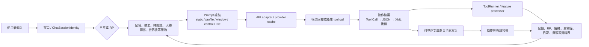

# Holt 系統地圖

這份地圖只描述目前源碼可確認的資料流、儲存位置與注入邊界。函式名稱會比行號穩定；不確定的部分集中放在各檔案最後。

## 一句話總覽

使用者訊息先進入窗口與模式範圍，再由 `StructuredPrompt` 把固定資料、窗口快照、控制規則和本輪召回組裝起來；模型回覆先經動作協議分流，正文回到消息表，工具動作再寫回各功能資料表。

## 完整路徑

## 子系統索引

| 文件 | 範圍 |
|---|---|
| [memory_entries.md](memory_entries.md) | 觸發詞、FTS5/BM25、向量、永久記憶、歸檔 |
| [spider_web_memory.md](spider_web_memory.md) | 蛛網記憶與關聯 |
| [emotion_coordinates.md](emotion_coordinates.md) | 情緒座標與 RP scope |
| [bio_clock.md](bio_clock.md) | 生物鐘與習慣 |
| [timeline.md](timeline.md) | 日常／RP 時間線 |
| [self_notes.md](self_notes.md) | 自我註記 |
| [summaries.md](summaries.md) | 日常／RP 摘要、標籤、段落召回、修復 |
| [rp_story.md](rp_story.md) | 人物、關係、狀態、RP 時間線、世界書 |
| [windows.md](windows.md) | 窗口、續章、版本、keep-alive、cache 身分 |
| [prompt_assembly.md](prompt_assembly.md) | 五層 Prompt 與 request-only live state |
| [tools_actions.md](tools_actions.md) | Tool Call、JSON、XML 後備與權限 |
| [shell_economy.md](shell_economy.md) | 貝殼、商店、背包、轉帳、刮刮卡、結婚 |
| [backup_import.md](backup_import.md) | 完整備份、可攜包、加密包、外部聊天匯入 |
| [ambient_motion.md](ambient_motion.md) | 主題背景粒子、幀率調度、可見性與省電邊界 |
| [app_startup.md](app_startup.md) | App 首幀、開屏、啟動補載與 iOS Debug 邊界 |
| [chat_composer.md](chat_composer.md) | 輸入框、發送鍵樣式與回覆前等待計時 |
| [notifications.md](notifications.md) | 回覆完成通知、鎖屏隱私、點擊導航與平台限制 |
| [sidebar_settings.md](sidebar_settings.md) | 設定側邊欄、群組展開與鍵盤收起協調 |
| [ui_operability.md](ui_operability.md) | 觸控熱區、大字體、多角色指示、語意與 reduced motion |

## 橫向文件

- [toggles.md](toggles.md)：設定開關會影響哪些子系統，以及日常／RP 是否生效。
- [scale.md](scale.md)：窗口與記憶量增大時，哪裡會先成為瓶頸。

## 閱讀順序

1. 先看本頁的資料流。
2. 要查一個功能的「誰寫入／誰注入」，進對應子系統文件。
3. 要查為什麼某功能沒有出現在 Prompt，先看 [prompt_assembly.md](prompt_assembly.md) 的五層邊界。
4. 要判斷資料是否跨模式或跨故事線，先看 [windows.md](windows.md) 與 [rp_story.md](rp_story.md)。

## 邊界

- 這不是產品規格，也不是未來施工單；它是目前代碼的讀圖。
- provider 實際 cache 命中、計費與背景執行結果不能只靠靜態源碼證明。
- 每次修改功能、資料流、Prompt、設定或 UI 執行邏輯時，都要同步更新對應的 `docs/map/` 文件與 `docs/handoff.md`；沒有既有分類時先補一份最小子系統地圖。
